<div align="center">

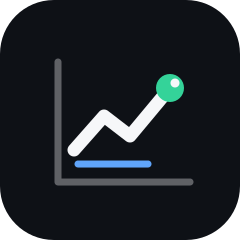

# Stockit

**Track. Read. Decide.**

Your stocks, the news around them and a plain-English story of what's going on.<br>Prices, key numbers explained, a Flash of top headlines with a TL;DR for each, and an optional AI briefing you can listen to.

An iPhone and iPad app for [Scriptable](https://scriptable.app). One file. No account, no server, no subscription.

[](CHANGELOG.md)
[](https://apps.apple.com/app/scriptable/id1405459188)
[](#ai-on-your-terms)
[](#not-financial-advice)
[](LICENSE)

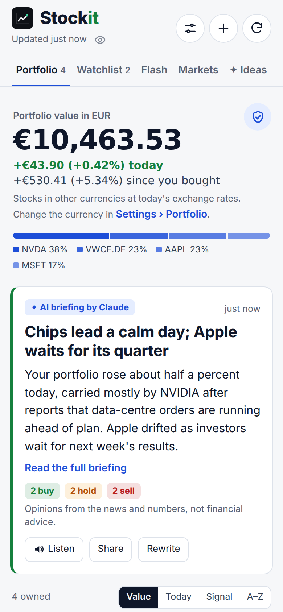&nbsp;
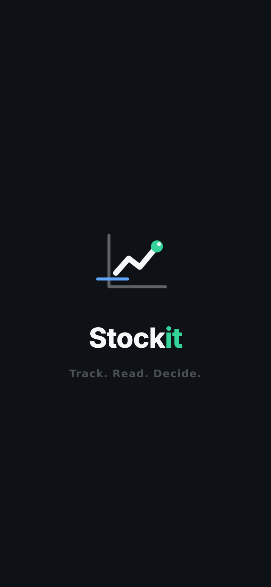&nbsp;
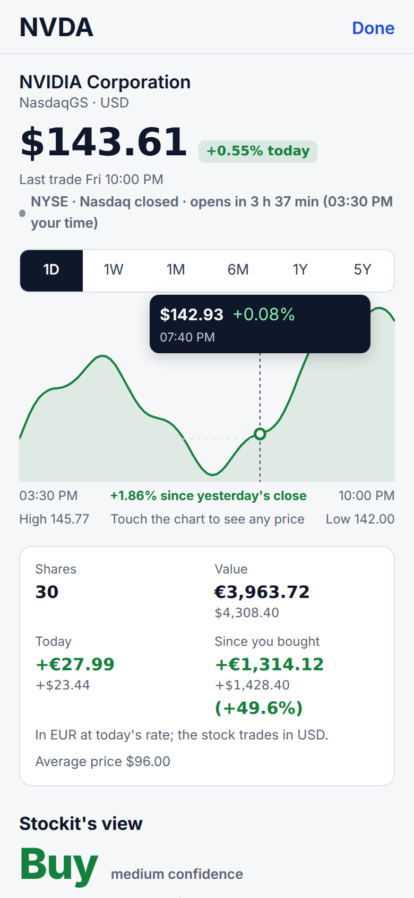&nbsp;
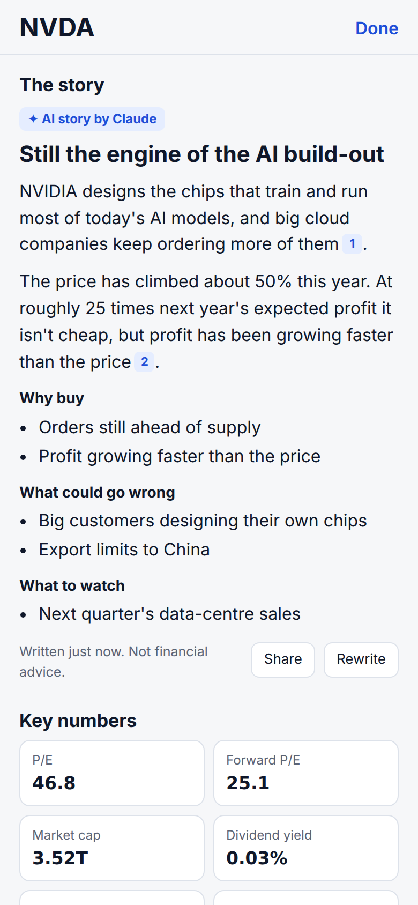

<sub>Your portfolio with the daily briefing · the launch screen · a stock's page · the story behind a stock</sub>

</div>

> [!IMPORTANT]
> **Stockit is not a financial adviser, and nothing in it is financial advice.** Buy, hold and sell views are opinions an AI model writes from the prices, numbers and headlines shown in the app. They can be wrong, late or incomplete. Do your own research and talk to a licensed adviser before you invest. See [Not financial advice](#not-financial-advice).

> Screenshots show sample stocks, prices and headlines.

## Install

1. Get **[Scriptable](https://apps.apple.com/app/scriptable/id1405459188)** (free) on your iPhone or iPad.
2. In Scriptable, tap **+**, paste these two lines, name the script *Stockit Installer*, and tap **▶**:
   ```js
   const code = await new Request("https://raw.githubusercontent.com/gadominas/Stockit/main/install.js").loadString();
   await eval("(async () => {" + code + "\n})()");
   ```
3. Tap **Open Stockit** and add your first stocks: search by name or ticker, paste a list like `AAPL 10 @ 150`, open a broker CSV, or use a screenshot.

To update, tap **Update now** when Stockit offers a new version, or run *Stockit Installer* again. Your stocks, strategies and settings are kept.

<details>
<summary><b>Install by hand</b></summary>

Rather not use the loader? Paste [`install.js`](install.js) or [`Stockit.js`](Stockit.js) into a new script in Scriptable yourself.

</details>

What else you need:

- **Nothing else is required:** no computer, no account, no sign-up.
- **Optional: AI.** Open **Settings › AI settings**, tap **Add key**, and paste a [Claude](https://console.anthropic.com/settings/keys) or [OpenAI](https://platform.openai.com/api-keys) API key. This switches on the daily briefing, a story and a view per stock, ideas and screenshot import. Without a key, Stockit now and then shows what AI adds, with a **Turn on AI** button.
- **Optional: the widget.** See [Home-screen widget](#home-screen-widget).
- **Optional: a Home Screen icon.** Make a Shortcut with **Run Script › Stockit**, add it to the Home Screen, and use [`docs/icon-1024.png`](docs/icon-1024.png) as its icon.

## Why Stockit

Most stock apps show you a price and a wall of headlines. Stockit is made for a casual investor who wants to know, in a couple of minutes a day, **how their money did and why**.

- **It opens on your money.** Portfolio value, today's change and the gain since you bought, before anything else.
- **It explains instead of dumping data.** Tap any number, such as P/E or beta, to see what it means in plain words. The briefing and stories read like a short newspaper piece, with numbered links to the headlines they use.
- **News in a flash.** The Flash tab puts each stock next to its top three headlines. Tap one for a TL;DR and what it could mean for the stock, then open the source only if it's worth it.
- **Listen instead of reading.** Tap a stock in Flash and Stockit reads three of its articles in full and tells them as one story. Or have the briefing, a TL;DR or the whole Flash read aloud while you walk or drive.
- **One place for the news.** Yahoo Finance, the wider web through Google News, and the crowd's mood from StockTwits, for each stock you own or watch.
- **Bring your stocks in fast.** Paste a list, open your broker's CSV export, or take a screenshot of Apple's Stocks app; no typing ticker by ticker.
- **Yours.** No account, no tracking, no subscription. Your data stays in your iCloud Drive and AI runs on your own key, with every token counted.

## A quick tour

<p align="center">
  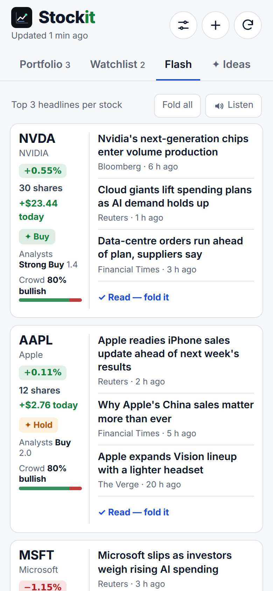&nbsp;
  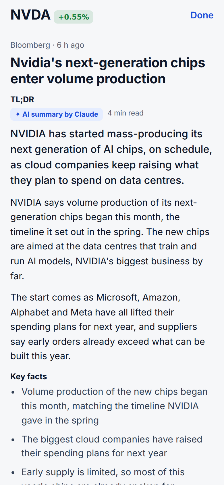&nbsp;
  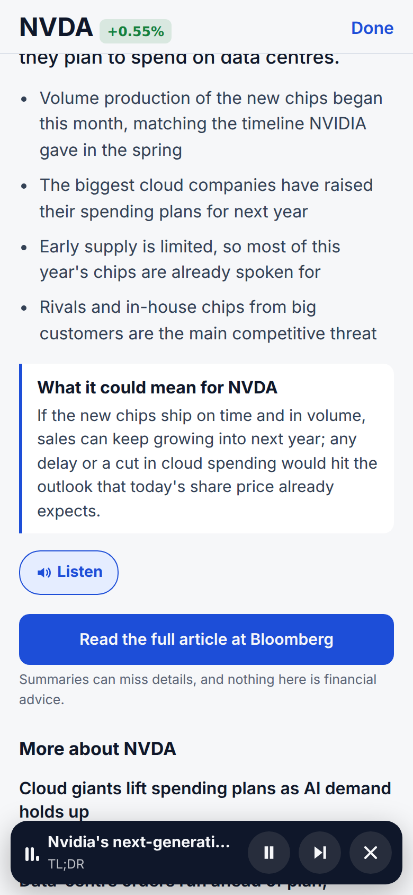
</p>
<p align="center"><sub><b>⚡ Flash</b>: every stock with its top headlines · <b>TL;DR</b> of any headline · <b>🔊 Listen</b>, then read the full article</sub></p>

<p align="center">
  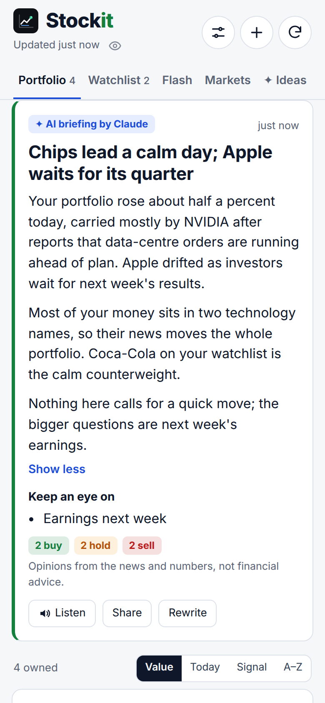&nbsp;
  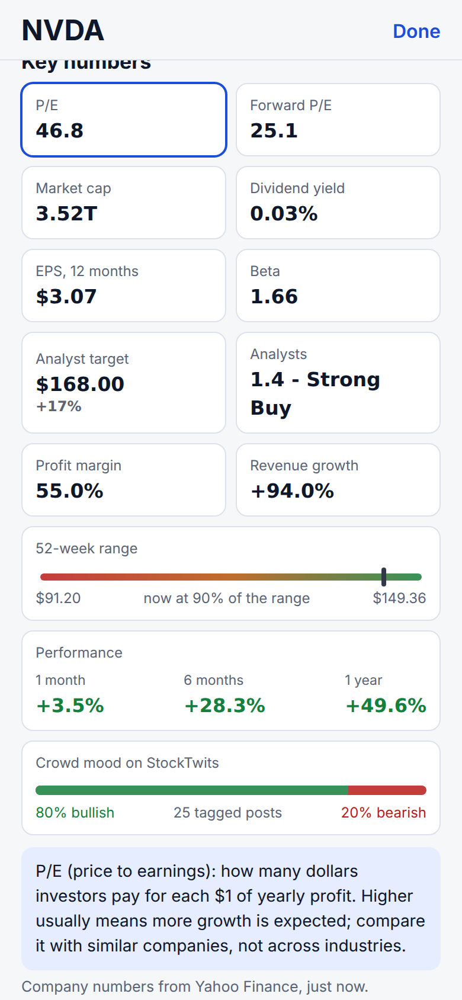&nbsp;
  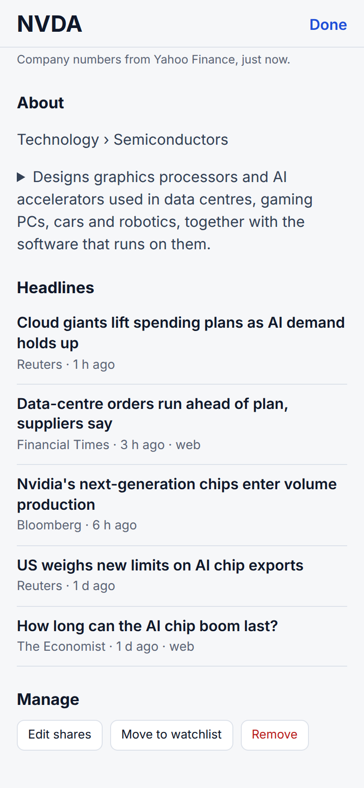
</p>
<p align="center"><sub><b>The daily briefing</b>, read in full · <b>Key numbers</b>, each explained on tap · <b>About and headlines</b> for every stock</sub></p>

<p align="center">
  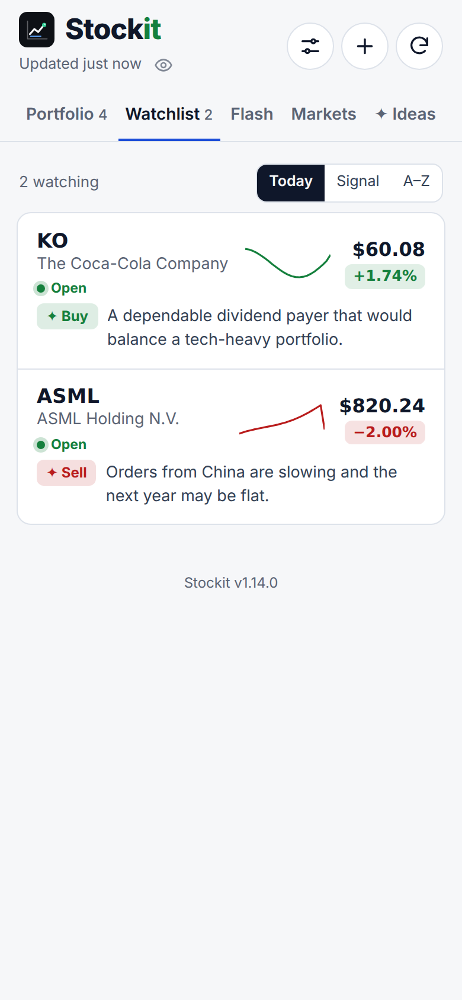&nbsp;
  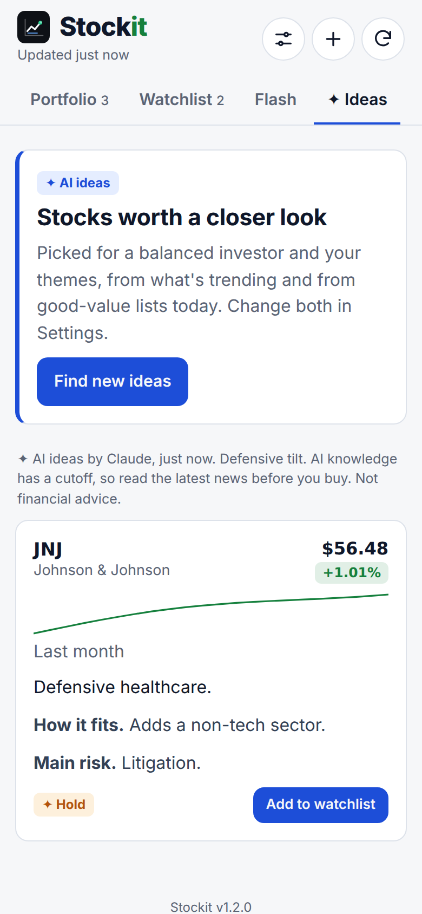&nbsp;
  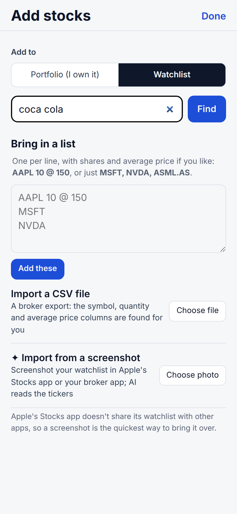
</p>
<p align="center"><sub><b>Watchlist</b> with trend lines and views · <b>✦ Ideas</b> that fit your style · <b>Add stocks</b> by search, list, CSV or screenshot</sub></p>

<p align="center">
  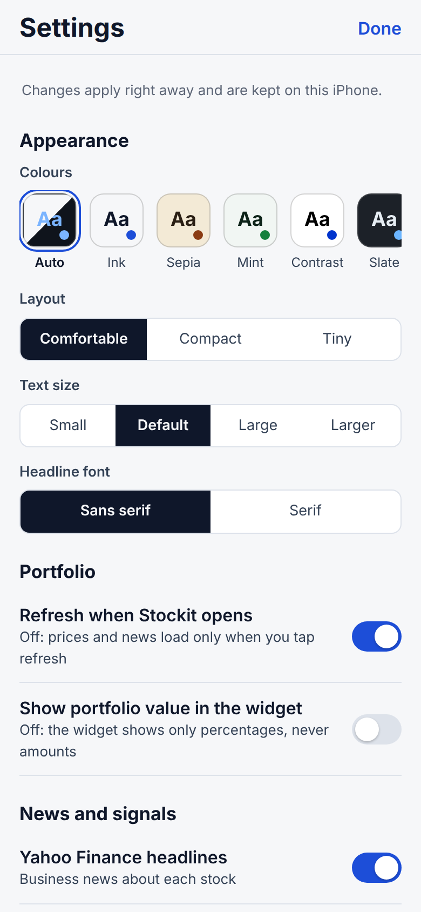&nbsp;
  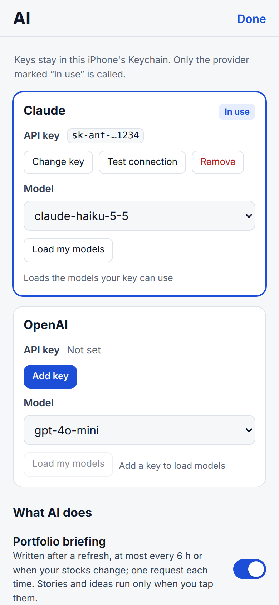&nbsp;
  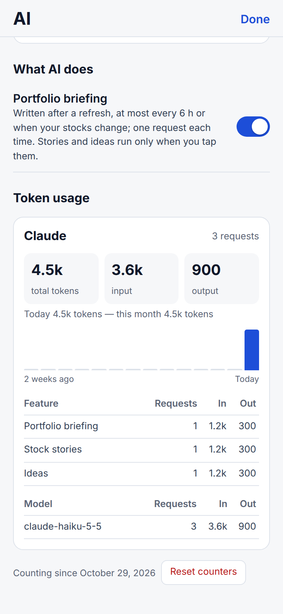
</p>
<p align="center"><sub><b>Settings</b>: every choice on screen · <b>AI settings</b>: your key, your model · <b>Token usage</b> per feature, model and day</sub></p>

<p align="center">
  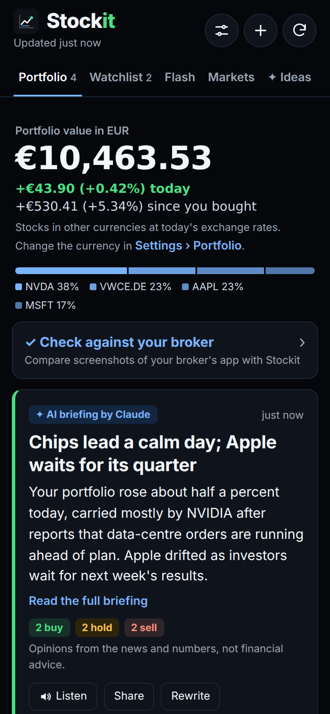&nbsp;
  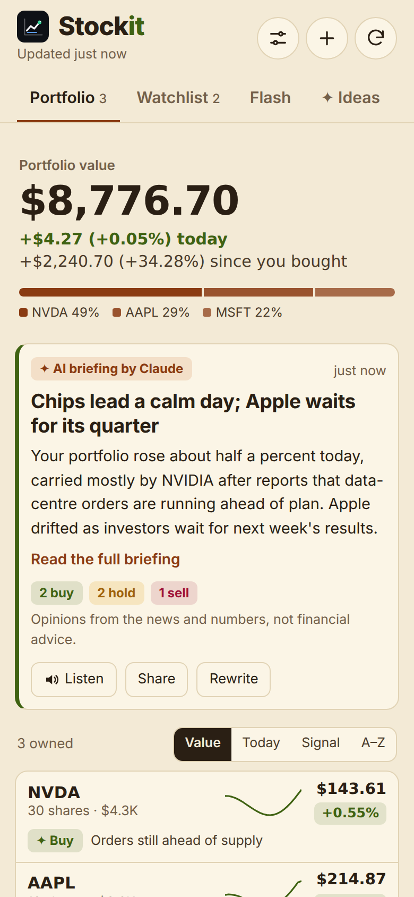
</p>
<p align="center"><sub><b>Dark mode</b> follows your iPhone · <b>Sepia</b> is one of six palettes</sub></p>

## What you get

| | |
|---|---|
| 💼 **Portfolio and watchlist** | Two tabs: stocks you own, with shares and average price, and stocks you watch. Each row shows the price, today's change, a one-month trend line and Stockit's view; owned stocks also show what you invested and what you've gained or lost, in your currency. Sort by value, today's move, signal or A–Z. |
| 💰 **Your money at a glance** | Portfolio value, today's change and the gain since you bought, with the split across your biggest holdings, all in **one currency you choose** (euros, dollars, pounds and more), whichever markets your stocks trade on. |
| 📊 **A page per stock** | 1D, 1W, 1M, 6M, 1Y and 5Y chart you can touch to see the price at any moment, whether its market is open, your position (value, today, since you bought), the price trend from the 50- and 200-day averages, and an About section. |
| 🔢 **Numbers, explained** | P/E, forward P/E, market cap, dividend yield, EPS, beta, analyst target, margins, growth, 50- and 200-day averages, RSI, 52-week range and 1, 6 and 12-month performance. Tap any of them for a plain-words explanation. |
| 🕒 **Markets** | Every stock shows whether its market is open right now. The Markets tab lists the markets where your stocks trade, then 16 others, each with a countdown to its next open or close, its hours in local and your time, and the trading day's progress. |
| 🧭 **My strategies** | ✦ Suggested strategies drawn from your portfolio, watchlist and plans, refreshed every day (or as often as you choose); keep any as your own. Or write down your own plans in Ideas, such as "when Nike recovers, sell it and buy a pharma company", with an optional timing. ✦ Ideas serve them and say where each one stands; the briefing and stories take them into account. Retire a strategy when it's done. |
| ⚡ **Flash** | A tab with every stock on the left and its top three headlines on the right, owned stocks first. Beside the headlines: your shares, today's profit or loss, Stockit's view, the analysts' average rating and the crowd's mood. Fold a card once read; it opens again when new headlines arrive. |
| ✂️ **TL;DR of any headline** | Tap a headline, in Flash or on a stock's page, for a one-line gist, the key points and what it could mean for the stock, then **Read the full article** at the publisher. ✦ AI writes it when you have a key; without one, the key sentences are taken from the article itself. |
| 🎧 **Listen to a stock's news** | Tap a stock in Flash: Stockit reads three of its articles in full (skipping any it can't open) and ✦ AI tells them as one spoken story of 350 to 550 words, naming its sources, then what it could mean for the stock. The story then appears under the card with its sources. Without a key, each article's key sentences are read in turn. |
| 🔊 **Read aloud** | **Listen to the briefing**, **Listen to the story**, **Listen to TL;DR**, the full **Article**, or the Flash **Headlines**. The player says what it's reading (STORY, TL;DR, FULL ARTICLE, SUMMARIES), shows how far along it is and the time left (tap the bar to jump), and highlights the sentence being read in the briefing, a story or a TL;DR; **Text** opens the whole text following the voice. Use your iPhone's own voices (free, offline) or a natural **✦ AI voice** from OpenAI. |
| 📰 **Headlines and the crowd** | Business news from Yahoo Finance, wider coverage from the web through Google News, and how StockTwits posts lean, bullish or bearish. Each source can be switched off. |
| ✦ **Daily briefing** | After a refresh, AI writes a short story of your portfolio today, what to keep an eye on, and a buy, hold or sell view with one line per stock. At most every 6 hours, or when your stocks change. Once you've read it and moved on, it folds down to its headline; tap to open it again. |
| ✦ **A story per stock** | What the company does, what's happening now and why, whether the price looks cheap or expensive, why buy, what could go wrong and what to watch, with numbered links to its sources. |
| ✦ **Ideas** | New stocks worth a closer look, picked for your investing style, your strategies and your themes, from what's trending and from good-value lists. Each comes with its key numbers and technicals (P/E, dividend yield, market cap, 50- and 200-day averages, RSI and more); tap one to open its full stock page before you add it. |
| 👁 **Privacy for demos** | One tap on the small eye at the top hides your amounts (value, gains, shares, average prices) as ••••, so you can show Stockit to anyone. Prices, percentages and charts stay. |
| 📸 **Check against your broker** | Upload screenshots of your broker's portfolio: ✦ AI reads every position and Stockit lists what's missing, what you no longer hold, and where shares, average prices or prices differ. Each is a suggestion you apply, edit or ignore; nothing changes on its own. |
| 📥 **Bring them in fast** | Search by name or ticker, paste a list (`AAPL 10 @ 150`, `MSFT, NVDA`), open a broker CSV export, or ✦ read the tickers from a screenshot. |
| 🎨 **Make it yours** | Six colour themes plus Auto (follows light and dark mode), Comfortable, Compact or Tiny layouts, four text sizes, sans or serif headlines. |
| 🎬 **Launch screen** | Stockit opens on its logo for 2.4 seconds: the price line draws itself, then "Track. Read. Decide." Tap to skip; with Reduce Motion it appears without movement. It is the shared [launch-screen](https://github.com/gadominas/app-blueprints/blob/main/blueprints/launch-screen.md) blueprint, so all the apps start the same way. |
| 🤖 **AI settings** | Claude or OpenAI, any model your key can use, a connection test, and token usage by provider, feature, model and day. |
| ⚙️ **Every setting on screen** | Time limits, how often prices, company numbers and headlines reload, AI limits, idea themes and widget timing. No code editing. |
| 🧩 **Built with** | The last section of Settings lists the [shared blueprints](https://github.com/gadominas/app-blueprints) Stockit follows, each linked at the exact version used (see [docs/BLUEPRINTS.md](docs/BLUEPRINTS.md)). |
| 📲 **Widget** | Today's move for your portfolio and your biggest movers on the Home Screen, in the same frame and colours as the other apps' widgets. |
| ⬆️ **Updates itself** | When a new version is out, Stockit shows its three best features and installs it with one tap. |

## Privacy for demos

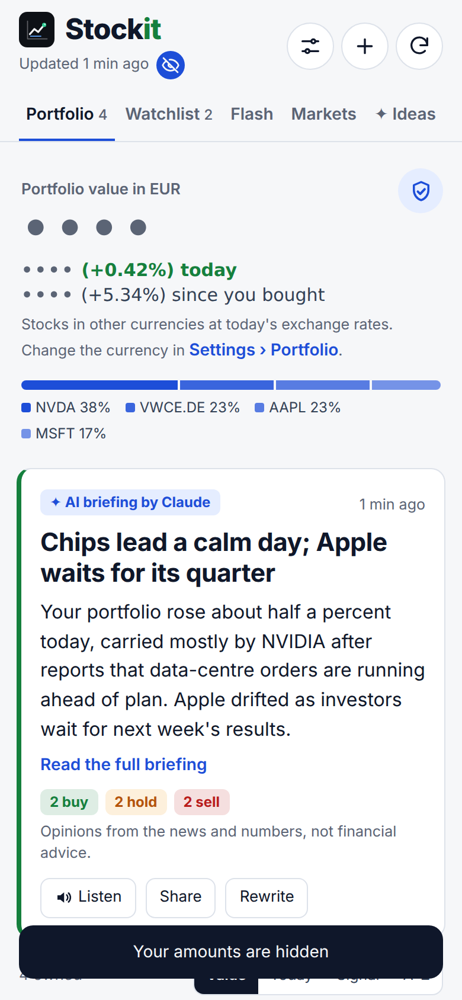

Showing Stockit to someone? Tap the **small eye** beside **Updated** at the top left. It turns blue and your amounts become **••••**:

- Portfolio value, today's change and gain since you bought (the percentages stay).
- Each stock's shares, value, today's money, gain and average price, on its page, in the lists and in Flash.
- The amounts in a portfolio check (editing waits until privacy is off).
- Amounts and share counts inside ✦ AI texts and in your strategies.
- The widget's amounts, even if **Show portfolio value in the widget** is on.

Market prices, percentages, charts, headlines and ideas stay visible, so the demo still shows everything Stockit does. Privacy stays on, even after closing Stockit, until you tap the eye again.

<br clear="right">

## Check against your broker

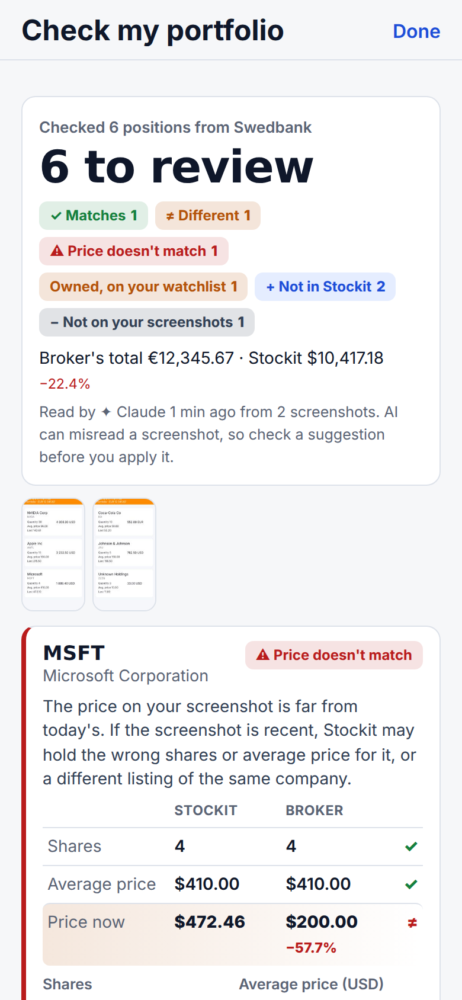

Is Stockit still in step with your real portfolio? Tap the **✓ shield icon** on your portfolio summary. (On your first three launches, a big **Check against your broker** button shows the way, then shrinks into that icon after a few seconds.)

1. **Add your broker's screenshots.** Each appears straight away as a numbered thumbnail; tap **×** to drop one or **+ Add another** if your portfolio takes several screens.
2. **Check them.** A progress bar shows each step while ✦ AI reads every position and Stockit compares it with yours.
3. **Review the results, all on one screen.** A summary counts each kind of result and compares the totals; then every stock has its own card, problems first, with a Stockit-versus-broker comparison marked ✓ or ≠ line by line:
   - **✓ Matches**: shares and average price agree.
   - **≠ Different**: different shares or average price. Edit the suggested numbers, then **Apply these** or **Keep Stockit's**.
   - **⚠ Price doesn't match**: the broker's price is far from today's. If the screenshot is recent, Stockit may hold the wrong shares or average price, or a different listing of the same company; correct them right there.
   - **+ Not in Stockit**: **Add to portfolio** with the shares and average price shown, or **Find it** if Yahoo doesn't know the name.
   - **− Not on your screenshots**: **Remove**, **Move to watchlist** or **Keep**, in case you sold it.
   - **Owned, on your watchlist**: **Move to portfolio**.

**Banks that show only totals work too.** Many banking apps show each position's price and its total value (often in euros), with the gain, but not the number of shares. Stockit then works out the shares as value ÷ price, and the average price as (value − gain) ÷ shares when everything is in the stock's own currency. A **Position value** line compares your broker's value with Stockit's. For a foreign stock valued in euros the shares go through today's rate and are marked approximate, and the average price is left alone, because banks count the gain at the exchange rates of the day you bought. Positions that show only a price are marked **✓ Price checked**. Cash accounts and account numbers on a screenshot are ignored.

<p align="center">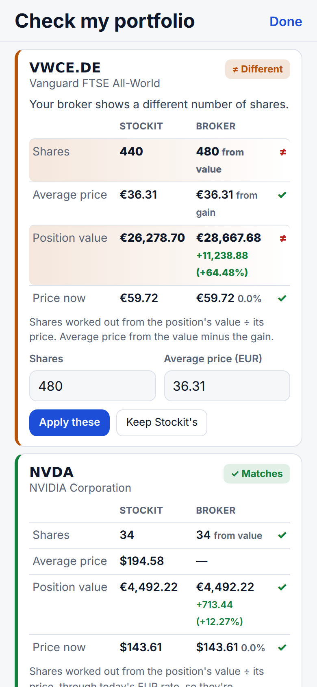</p>

**Nothing changes on its own.** Each suggestion waits for your tap and is marked once handled. Tolerances (1% for average prices and 5% for prices by default) and the number of screenshots are in **Settings › Portfolio check**.

<p align="center">
  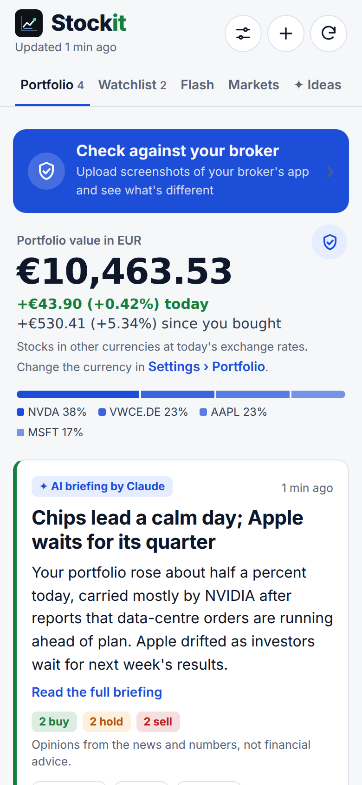&nbsp;
  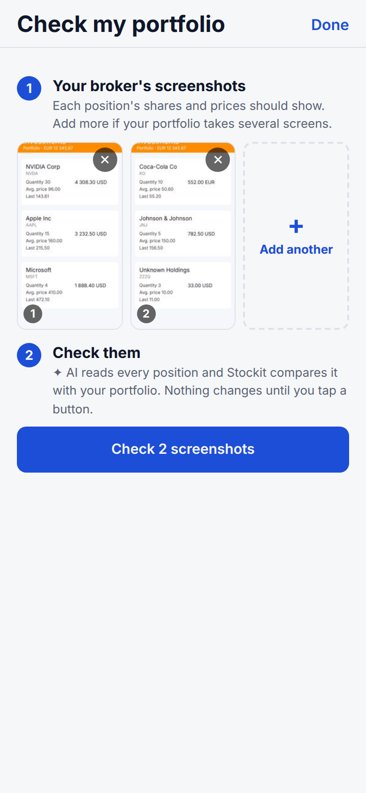&nbsp;
  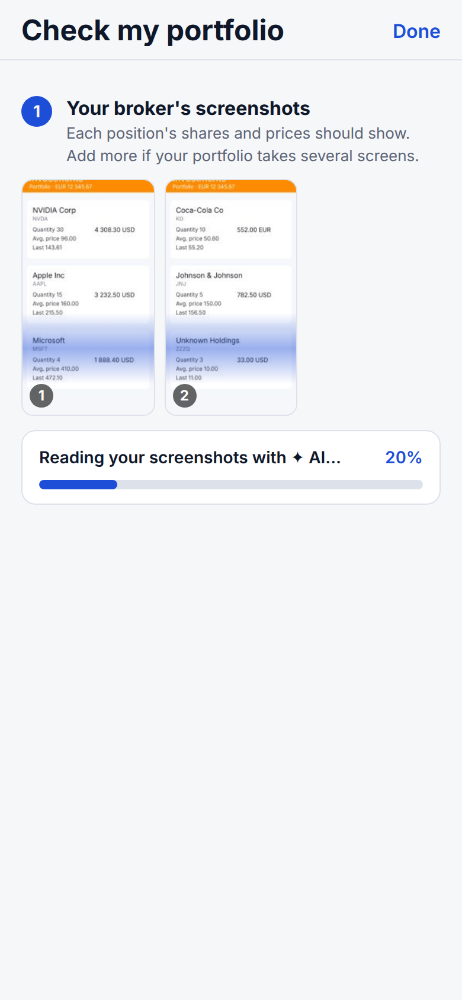&nbsp;
  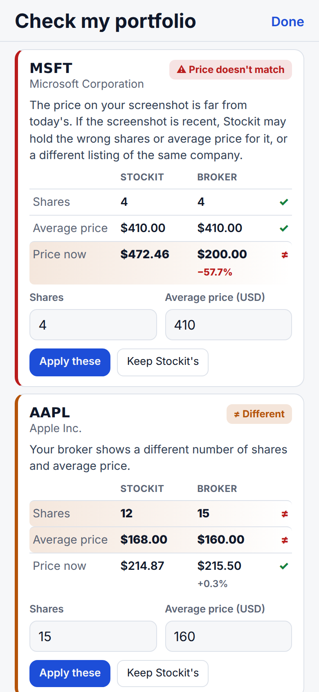
</p>
<p align="center"><sub><b>First launches</b>: the big button · <b>Your screenshots</b>, shown at once · <b>Reading</b>, with progress · <b>Every stock marked</b>, ready to correct</sub></p>

<br clear="right">

## One currency for everything

If you own stocks on several markets, Stockit adds them all up in one currency. Choose it in **Settings › Portfolio › Show your money in**: **Auto** (the currency most of your money is in), EUR, USD, GBP, CHF, SEK, NOK, DKK, PLN, JPY, CAD, AUD or HKD.

- **Portfolio value, today and since you bought** are in that currency, here and in the widget (when **Show portfolio value in the widget** is on).
- Each stock's page shows its value, today and gain in your currency, with the stock's own currency underneath. Its price stays in the currency it trades in.
- Exchange rates come from Yahoo Finance with your prices. Today's change includes the currency's own move since yesterday; what you paid is converted at today's rate.
- London prices quoted in pence are converted to pounds first.

## Charts you can touch


Every stock's page has a chart from **one day** to **five years**: 1D (every five minutes, against yesterday's close), 1W, 1M, 6M, 1Y and 5Y.

**Touch or drag across the chart** to see the price, the time or date and the change at that moment. The line and the price stay a moment after you let go. Vertical swipes still scroll the page.

<br clear="right">

## Markets: open or closed

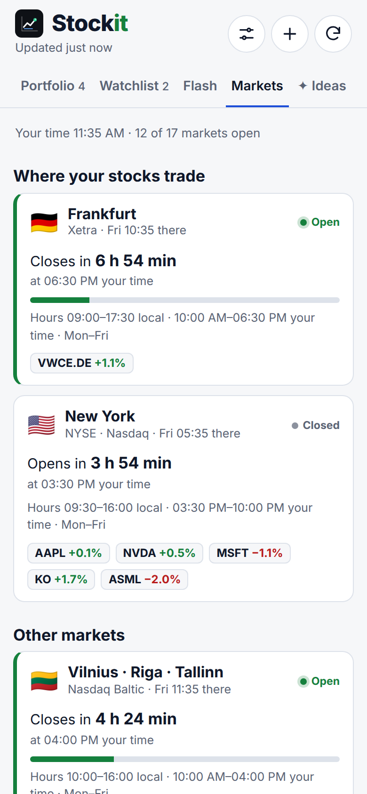

Every stock in Portfolio, Watchlist and Flash shows **Open** or **Closed** for its market, and its page says when it closes or opens, in your time.

The **Markets** tab shows the markets where your stocks trade first, then the other big ones: New York, Toronto, London, Frankfurt, Euronext, Zurich, Milan, Madrid, Stockholm, Copenhagen, Helsinki, Oslo, Warsaw, Vilnius · Riga · Tallinn, Tokyo, Hong Kong, Sydney and crypto. Each one says:

- **Open, Closed or Lunch break**, with a countdown: "Closes in 2 h 20 min" or "Opens in 4 h 50 min", and the time that is for you.
- Its hours in local time and in yours, and how far through the trading day it is.
- Which of your stocks trade there, with today's move (tap one to open it).

Hours follow each exchange's own time zone, so summer and winter time are right everywhere. For markets where you hold stocks, Yahoo's session times also catch public holidays.

<br clear="right">

## Ideas you can judge

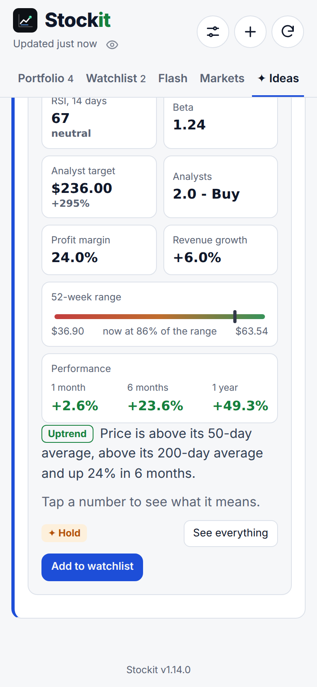

The **Ideas** tab has three sections that fold open and closed (Stockit remembers which you folded): **My strategies**, **Themes you like** and **✦ Stocks worth a closer look**.

- **Themes you like** are right in the tab: tap **×** to remove one, type a new one and tap **Add**. ✦ Ideas look for stocks that fit them, together with your strategies.
- **Every idea comes with the numbers to judge it**: P/E and forward P/E, dividend yield, market cap, the 50-day and 200-day moving averages (and how far the price is from each), RSI over 14 days, beta, the analysts' target and rating, profit margin and revenue growth, plus its sector, exchange, 52-week range, 1, 6 and 12-month performance and price trend. Tap any number to see what it means.
- **Tap an idea** (its ticker or **See everything**) to open its full stock page, exactly as for a stock on your lists: charts from 1D to 5Y, numbers, headlines with TL;DRs, the ✦ story and whether its market is open. Then **Add to watchlist** or **I own this**, or just close it.

<br clear="right">

## My strategies

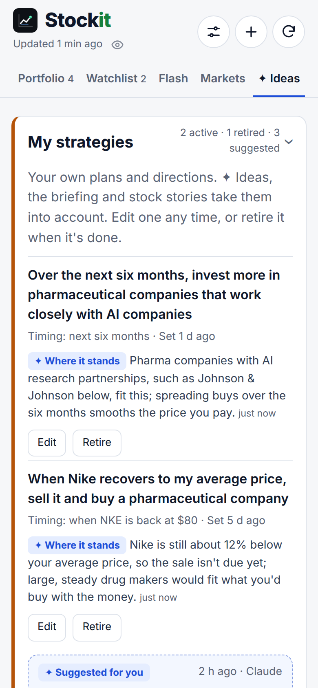

In **Ideas › My strategies**, write down your own plans and directions, in your own words, with an optional timing. For example:

- "When Nike recovers to my average price, sell it and buy a pharmaceutical company" (timing: "when NKE is back at $80").
- "Over the next six months, invest more in pharma companies that work closely with AI companies."

All your strategies are listed there. **Edit** one any time to change its words or timing. **Retire** one when it's done or no longer what you want; retired strategies stay under **Retired strategies**, where you can bring them back or delete them.

**✦ Suggested for you.** With an AI key, Stockit suggests three new strategies (one to five, in **Settings › Strategy suggestions**) from your portfolio, watchlist, your own strategies, your themes and today's prices in your currency. Each is written the way you'd write it, with a timing, the numbers behind it and the tickers involved (tap one to open it). **Keep** it as it is, **Edit, then keep** to make it yours first, or **Dismiss** it.

Suggestions refresh on their own, so they're never stale: every day by default, or every 6 hours, 12 hours, 2 days, or only when you tap **Refresh now**. You choose right under the suggestions. They refresh when Stockit opens, after a refresh, or when you open Ideas, and each refresh also updates **Where it stands** for your own strategies.

<p align="center">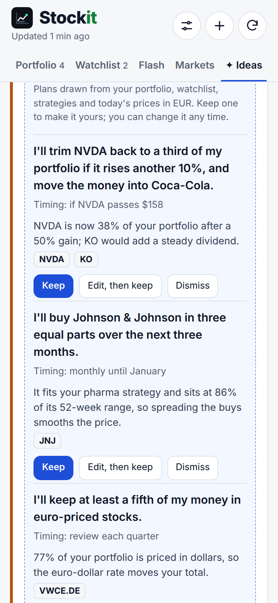</p>

With an AI key, your active strategies come first when Stockit looks for ✦ ideas: ideas serve them, each says which strategy it is for, and every strategy gets a short **Where it stands**, such as how far a stock is from your average price. The daily briefing and stock stories take your strategies into account too.

<br clear="right">

## Flash news and TL;DRs


Open the **Flash** tab for a two-minute scan of everything you own and watch: each stock on the left, its top headlines on the right (three by default, 1 to 5 in **Settings › Headlines**). Headlines that name the company and come from well-known sources rank first; quote and listing pages are left out.

The left column shows what matters for that stock at a glance:

- **Today's move** and, for stocks you own, **your shares** and **today's profit or loss** in the stock's currency.
- **Stockit's view:** ✦ buy, hold or sell from the AI, or the price trend without a key.
- **Analysts:** the average Wall Street rating from Yahoo Finance, from 1 (Strong Buy) to 5 (Sell).
- **Crowd:** how StockTwits posts lean, with a bullish-versus-bearish bar.

**🎧 Tap a stock** (its ticker, or **Listen** on the card) to hear the story of its news. Stockit opens the top three articles and reads them in full; if one can't be opened, it reads the next headline instead. ✦ AI then tells them as one story of a few minutes: what happened, each article's facts and numbers, how the pieces connect, where each fact comes from, and what it could mean for the stock. Tap the stock again to pause. **Listen** at the top does the same for every open card in turn. The player starts at once; the first story takes a few seconds while the articles are read, and the next one is prepared while you listen.

The story then appears under the card as **The story you heard**, with each source and whether it was read in full or only from its headline. **Details ›** opens the stock's page.

<p align="center">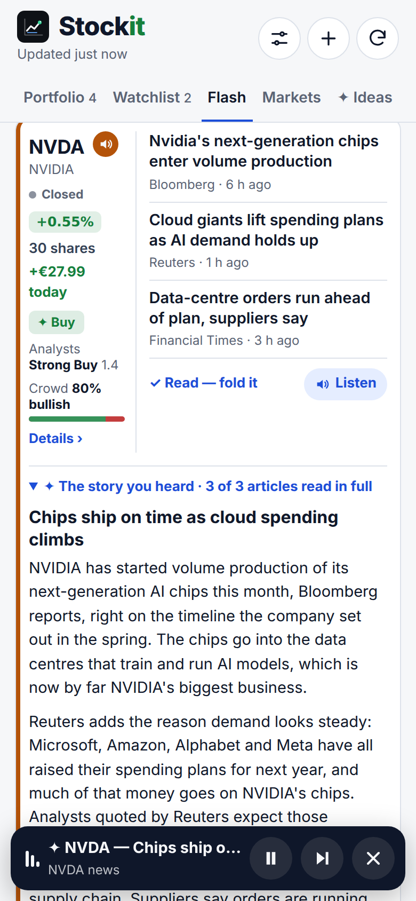</p>
<p align="center"><sub><b>Tap a stock</b>: its three articles, told as one story, with the text under the card</sub></p>

Once you've read a card, tap **✓ Read — fold it**. It shrinks to one line and stays folded until a newer headline arrives; then it opens again, marked **New since you folded it**. **Fold all** and **Open all** are at the top, and **Listen** reads only the open cards.

<p align="center">
  &nbsp;
  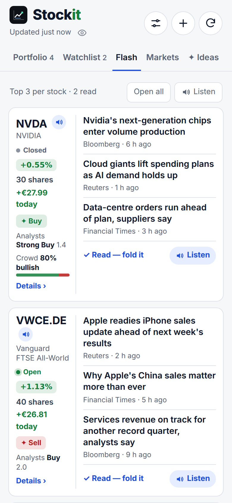
</p>
<p align="center"><sub><b>Flash</b>: your stake, the view and the mood beside the news · <b>Folded</b> cards once read</sub></p>

Tap a headline to open its **TL;DR**:

- **The gist** in one sentence, **the story** in two or three paragraphs, the **key facts** and **what it could mean** for the stock.
- **✦ AI summary** when you have a key, labelled with the provider. Without a key, Stockit picks the key sentences from the article itself, labelled **no AI**.
- **Listen to TL;DR** reads the summary aloud, highlighting each sentence as it goes; **Article** reads the whole original article (it starts speaking at once, and falls back to the summary if the page can't be read).
- **Read the full article** opens it in Stockit's **reader**: the article's own text with its picture, author and reading time, **Listen** (the text lights up as it's read), and **✦ Ask AI** with suggested questions ("What's the main point?"). When a site asks for consent or a sign-in first, the reader says so and offers the original; **Original ↗** opens it at the publisher. To open articles in Safari instead, switch off **Settings › News and signals › Open articles in the reader**.
- **More about** the same stock is listed underneath, one tap away.

Google News links are followed to the publisher's own article. Some articles still can't be read from the phone (paywalls, cookie walls, pages that need JavaScript). The TL;DR then explains only the headline and summary, and says so. TL;DRs are kept on your phone, so opening one again is instant.

<br clear="right">

## Read aloud

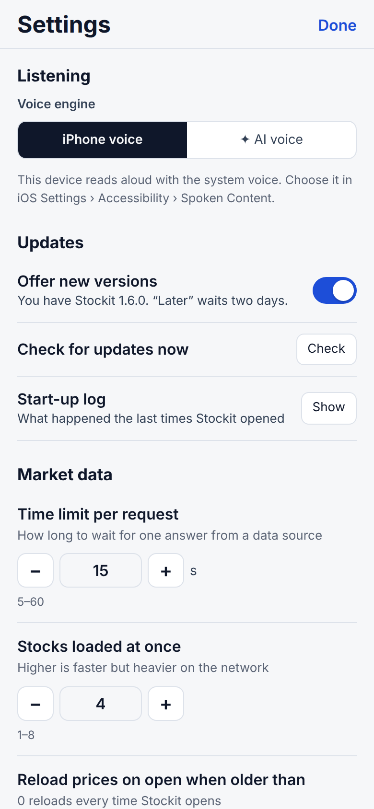

Tap **Listen to the briefing**, **Listen to the story**, **Listen to TL;DR**, **Article** on a news item, or **Headlines** on the Flash tab. A player appears at the bottom with what it's reading (a coloured STORY, TL;DR, FULL ARTICLE or SUMMARIES label), a progress bar with the time left (tap it to jump), and **Text**, pause, next and stop. While the briefing, a story or a TL;DR is read, its current sentence lights up and the ones already read dim; **Text** opens the whole text in a sheet that follows the voice, and tapping any sentence jumps there. The stock being read is marked in Flash. It's the shared [read-aloud](https://github.com/gadominas/app-blueprints/blob/main/blueprints/read-aloud.md) blueprint, so every app reads aloud the same way.

Choose the voice in **Settings › Listening**:

- **iPhone voice:** free and offline. Filter female or male voices, set speed and pitch. For more natural voices, download an Enhanced or Premium voice in iOS Settings › Accessibility › Spoken Content › Voices.
- **✦ AI voice:** OpenAI's speech models, with a choice of voices and a style such as "calm newsreader". This needs an OpenAI key, even when Claude writes your briefing, because Claude's API has no speech output. Characters sent are counted under Token usage as *Read aloud*.

<br clear="right">

## Home-screen widget

<p align="center">
  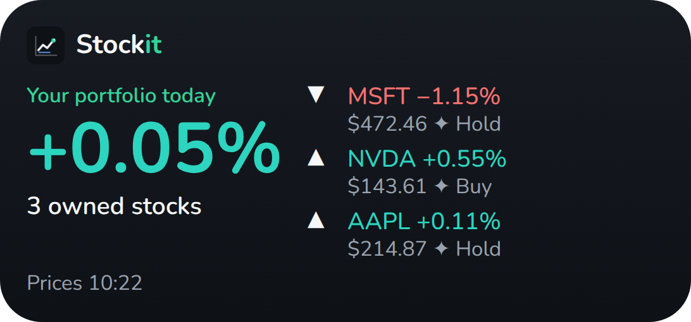&nbsp;&nbsp;
  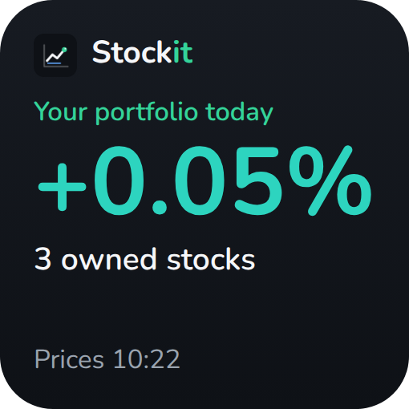
</p>
<p align="center">
  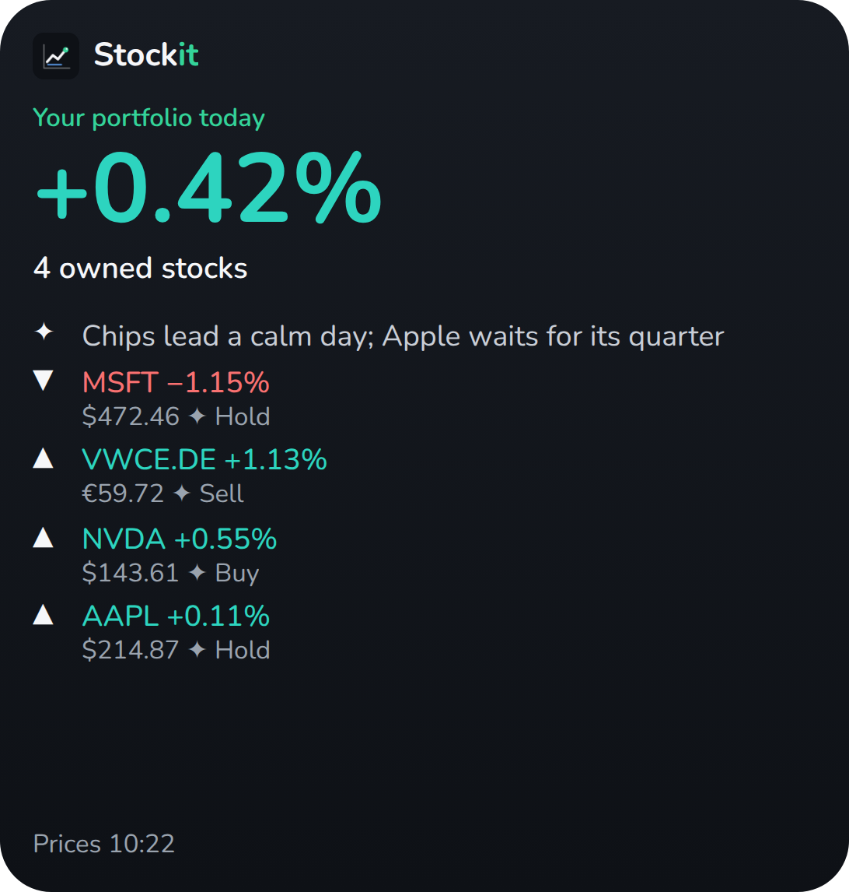
</p>
<p align="center"><sub><b>Medium</b>: today's move and the biggest movers · <b>Small</b>: today's move · <b>Large</b>: adds the ✦ briefing headline</sub></p>

1. Long-press your Home Screen, tap **Edit → Add Widget**, choose **Scriptable**, and pick a size.
2. Long-press the new widget, tap **Edit Widget**, and set **Script** to *Stockit*.

The widget shows the Stockit logo and name and your portfolio's move today (or your watchlist's, before you own anything). The medium widget lists your three biggest movers beside it, with their price and view; the large one adds the latest ✦ briefing headline and more rows. Tapping opens Stockit. The bottom line says when prices were loaded, and turns amber (**⟳ Updated …**) when that is older than 12 hours. Lock Screen widgets show today's move as text.

The widget **shows percentages only**, never amounts of money, because it sits on an unlocked Home Screen. Turn on **Settings › Portfolio › Show portfolio value in the widget** if you want the value too.

It reloads prices itself when they are older than 30 minutes, within 15 seconds, and otherwise shows what Stockit last saved; it never calls AI. Change these times in **Settings › Widget**.

## AI, on your terms

AI is optional. Without it, everything else works: prices, numbers and their explanations, headlines, the crowd's mood, and a price-trend view from the moving averages, labelled **no AI**.

- **Your key, your choice.** Add a Claude or OpenAI key in **Settings › AI settings**, tap **Load my models**, and pick any model your account can use. Switch providers any time.
- **You see the cost.** Token usage is counted per provider, feature, model and day, with a 14-day chart.
- **It only runs when it helps.** The briefing is one request after a refresh, at most every few hours. Stories, TL;DRs, ideas, AI voices and screenshot import run only when you tap them.
- **Your investing style.** **Settings › AI advice** sets Cautious, Balanced or Adventurous; it shapes the views and the ideas.
- **Clearly labelled.** Everything AI-written carries a **✦ AI** label and the name of the provider that wrote it, and every view says it is not financial advice.

API usage is billed by Anthropic or OpenAI, separately from any Claude or ChatGPT subscription. A daily briefing with a small model usually costs well under a cent.

## Using it

| To… | Do this |
|---|---|
| Add a stock | Tap **+**, choose **Portfolio** or **Watchlist**, search by name or ticker, then **Add** |
| Add many at once | Tap **+** and paste one per line (`AAPL 10 @ 150`), open a CSV, or **Choose photo** for a screenshot |
| See a stock's page | Tap its row |
| Understand a number | Tap the number on the stock's page |
| Read the briefing in full | Tap **Read the full briefing** |
| Get a stock's story and view | Open the stock and tap **Write the story** |
| Find new ideas | Open **✦ Ideas** and tap **Find new ideas**; **Add to watchlist** keeps one |
| Change shares or move a stock | Open the stock › **Manage** › **Edit shares**, **Move to watchlist** or **Remove** |
| See the price at any moment | Open a stock and touch or drag across its chart; **1D** and **1W** show the day and the week |
| See everything in euros (or dollars) | **Settings › Portfolio › Show your money in** |
| See which markets are open | Look for **Open** or **Closed** under each stock, or open **Markets** |
| Hide your amounts for a demo | Tap the small **eye** beside **Updated**; tap again to show them |
| Check Stockit against your broker | Tap the **✓ shield** on your portfolio, add screenshots, tap **Check**, then apply or ignore each suggestion |
| Look at an idea closely | **Ideas**, tap the idea's ticker or **See everything** |
| Change the themes for ideas | **Ideas › Themes you like** |
| Take a suggested strategy | **Ideas › My strategies › Suggested for you**, **Keep** or **Edit, then keep** |
| Change how often suggestions refresh | The **Refresh every** menu under the suggestions |
| Add your own plan | **Ideas › My strategies**, write it, add a timing if you like, tap **Add strategy** |
| Put a plan aside | **Retire** on the strategy; bring it back from **Retired strategies** |
| Scan the news | Open **Flash** |
| Put a read card away | Tap **✓ Read — fold it**; tap the folded line to open it again. **Fold all** and **Open all** are at the top |
| Get the gist of a headline | Tap it, in Flash or on a stock's page, for its TL;DR |
| Read the whole article | In the TL;DR, tap **Read the full article at …** |
| Hear a stock's news as a story | Tap the stock in **Flash** (tap again to pause); **Headlines** at the top plays every open card in turn |
| Read the story you heard | Open **The story you heard** under the card |
| Listen instead of reading | **Listen to the briefing**, **Listen to the story**, **Listen to TL;DR** or **Article**. Pause, skip, stop or jump from the player; **Text** shows the words as they're read |
| Change the voice | **Settings › Listening**: **iPhone voice** or **✦ AI voice**, then **Test the voice** |
| Refresh prices and news | Tap refresh |
| Change anything else | Tap **Settings** |

## Updates and what's new

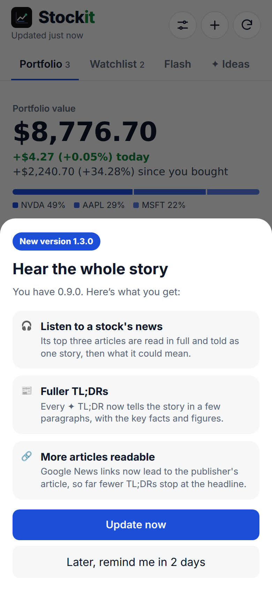

Stockit checks this repository for a newer version each time it opens. If there is one, it shows the three best features and offers **Update now**. **Later**, or tapping outside, waits two days before offering it again. You can also check any time in **Settings › Updates**, or simply run the installer again.

See [CHANGELOG.md](CHANGELOG.md) for every release. Maintainers: release notes live in [`releases.json`](releases.json); see [docs/RELEASING.md](docs/RELEASING.md).

<br clear="right">

## Not financial advice

Stockit is a personal tool for following the stocks you care about. It is **not a financial adviser, broker or research service**, and nothing it shows is a recommendation to buy, sell or hold any security.

- **AI views are opinions.** The buy, hold and sell views, briefings, stories and ideas are written by an AI model from the prices, company numbers and headlines Stockit loaded. Models make mistakes, can misread a headline, and know nothing that isn't in that data.
- **Ideas need checking.** AI models have a knowledge cutoff, so read the latest news on any idea before you act.
- **Data can be late or wrong.** Prices, numbers and headlines come from free public sources and can be delayed, incomplete or incorrect.
- **You decide.** Investing carries risk, including the loss of what you put in. Do your own research and consider talking to a licensed financial adviser.

The software is provided "as is", without warranty of any kind; see the [LICENSE](LICENSE).

## Privacy and security

- **Anonymous usage, only if you agree.** A one-time question (and **Settings › Privacy › Share anonymous usage**) decides whether Stockit sends anonymous counts to PostHog's US cloud: app opens, how many stocks were added, briefings, stories and ideas made, portfolio checks, strategies saved, listening, articles opened in the reader and questions asked about them, the app version and a few display settings (including whether privacy mode is on). Each event carries a random install ID made on your phone, not linked to anything else. Never sent: tickers, company names, prices, amounts, positions, strategies, screenshots, articles or your questions. Turning it off stops sending and deletes the install ID.

- **Everything runs on your phone.** There is no Stockit server, and nothing is collected unless you agree to the anonymous usage counts below.
- **Your data** (stocks, shares, average prices, settings, loaded prices and headlines, AI texts) is stored as JSON in **iCloud Drive › Scriptable › Stockit**. The widget's snapshot stays on the device.
- **Your keys** (Claude, OpenAI and the optional Finnhub key) are stored in the iOS Keychain and only ever sent to the service they belong to.
- **What goes to the AI:** prices, company numbers and headlines, and for the briefing your portfolio's makeup (which stocks you own and how much of each), and your strategies, so it can talk about your money and your plans; for a portfolio check, the screenshots you choose; for a TL;DR or a stock's news story, the articles' text. Only when a feature needs it, and only to the provider you chose. With ✦ AI voice, the text being read goes to OpenAI.
- **Network requests** go to Yahoo Finance, Google News and StockTwits for data, the publisher's page when you open a TL;DR, Finnhub if you add a key, your AI provider, and this repository for update checks.

## Where the data comes from

| Data | Source | Notes |
|---|---|---|
| Prices and history | Yahoo Finance | No key needed |
| Company numbers and analyst views | Yahoo Finance; optional [Finnhub](https://finnhub.io) key as a backup | Add the key in **Settings › News and signals** |
| Headlines | Yahoo Finance and Google News | Switch either off in Settings |
| Crowd mood | StockTwits | US tickers |

Yahoo Finance and StockTwits are used through their public web endpoints, which are not official APIs and can change without notice. When a source doesn't answer, Stockit keeps what it last loaded and tells you which stocks it couldn't update.

## How it works

Stockit asks the sources above for each stock you follow, stores the results on your phone, and shows them in a page rendered by Scriptable. The price trend comes from the 50- and 200-day moving averages; the AI features send a compact summary of the same data to Claude or OpenAI and ask for a JSON answer, which Stockit checks before showing. The widget is drawn natively by Scriptable from a snapshot the app saves.

Stockit follows five shared blueprints: in-app updates, settings, AI configuration, launch screen and widgets. **Settings › Built with** lists them with their versions; [docs/BLUEPRINTS.md](docs/BLUEPRINTS.md) adds the deviations.

## Troubleshooting

| Problem | Try this |
|---|---|
| Stockit opens to a blank or loading screen | Close it and open it again. If it keeps happening, open **Settings › Updates › Start-up log** and send what it shows |
| Some money shows "until their exchange rates load" | That currency's rate hasn't loaded yet. Tap refresh; it's kept for 30 minutes after that |
| A market shows open on a public holiday | Holidays are known for markets where you hold stocks, after a refresh; other markets follow their regular weekly hours |
| A stock isn't found | Use its Yahoo Finance ticker, with the exchange suffix outside the US (`ASML.AS`, `VWCE.DE`) |
| "Updated; couldn't load …" | That source didn't answer. Tap refresh again in a minute; the last loaded data stays on screen |
| Company numbers are missing | Yahoo sometimes doesn't answer for these. Add a free Finnhub key in **Settings › News and signals** as a backup |
| A story says some articles were headline only | Those pages block reading from apps. Stockit already tried up to eight headlines; open the sources under **The story you heard** to read them yourself |
| A TL;DR says the article couldn't be read | The publisher blocks reading from apps (paywall or cookie wall). Tap **Read the full article** to read it at the source |
| The voice sounds robotic | Download an Enhanced or Premium voice in iOS Settings › Accessibility › Spoken Content › Voices, then pick it in **Settings › Listening**, or switch to **✦ AI voice** |
| The briefing, views or Ideas are missing | They appear once an AI key is saved in **Settings › AI settings** |
| "Key saved, but checking it failed" | The key was rejected or has no credit. Tap **Change key** and paste a valid one |
| The CSV import finds no stocks | The file needs a symbol or ticker column. Or paste the tickers instead |
| The widget shows **⟳ Updated …** in amber | Open Stockit once; the widget updates from it |
| An update says GitHub is serving the old version | Wait a few minutes after a release and tap **Try again** |

## Contributing

Issues and pull requests are welcome. Keep everything in a single Scriptable file, with no build step, and test on a real device. To release, follow [docs/RELEASING.md](docs/RELEASING.md).

## License

[MIT](LICENSE) © 2026 Gediminas Siutilas
